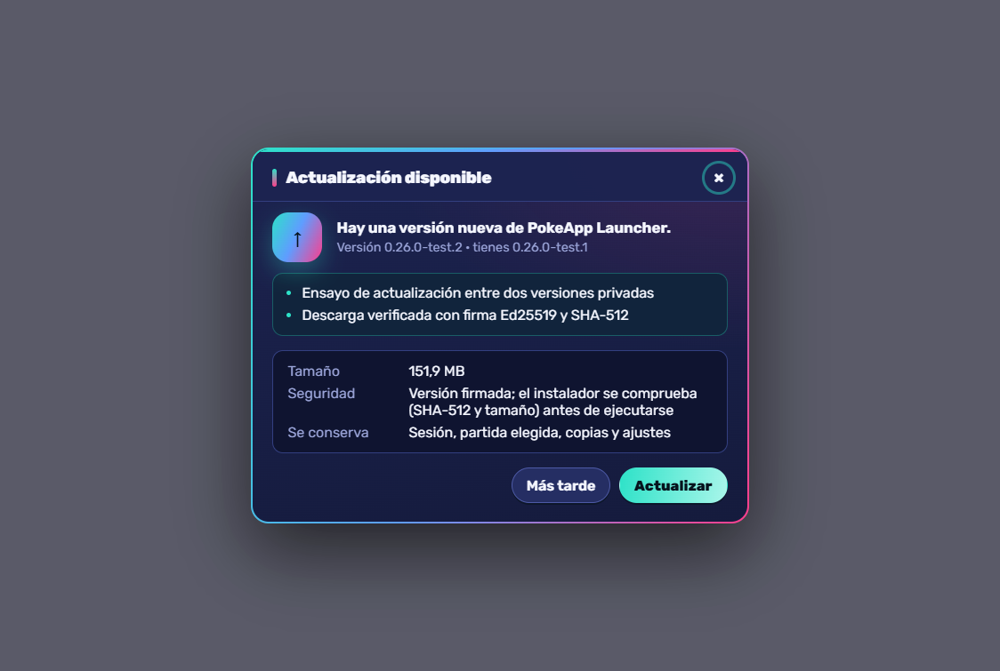
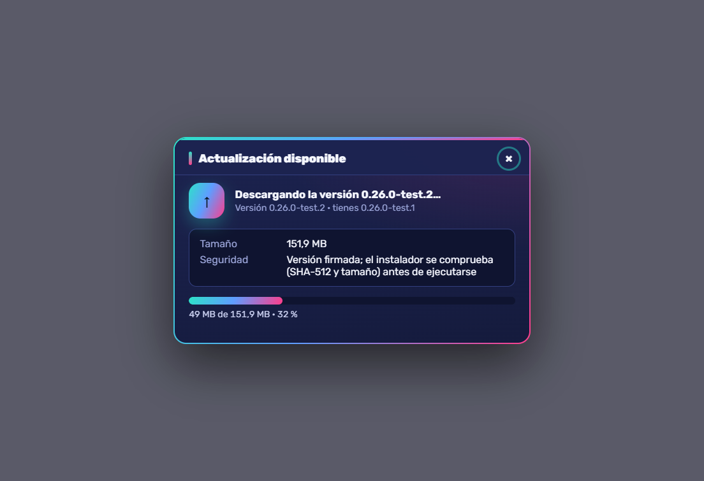
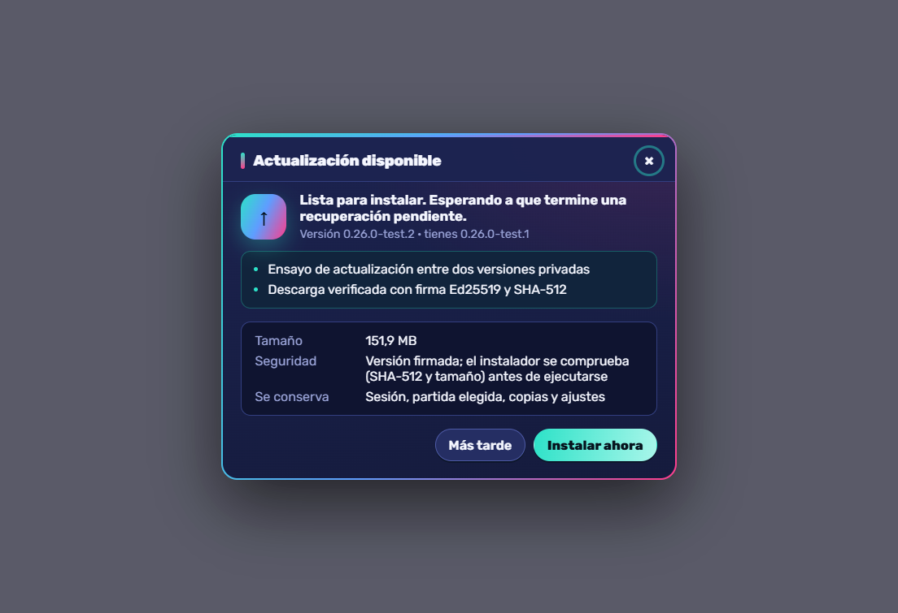
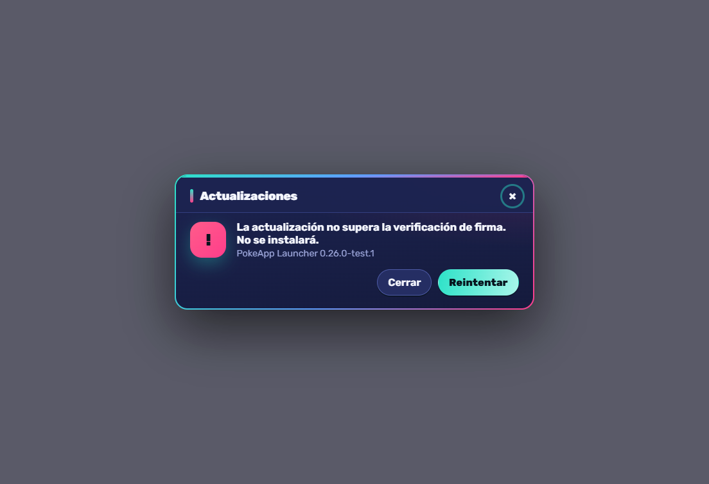
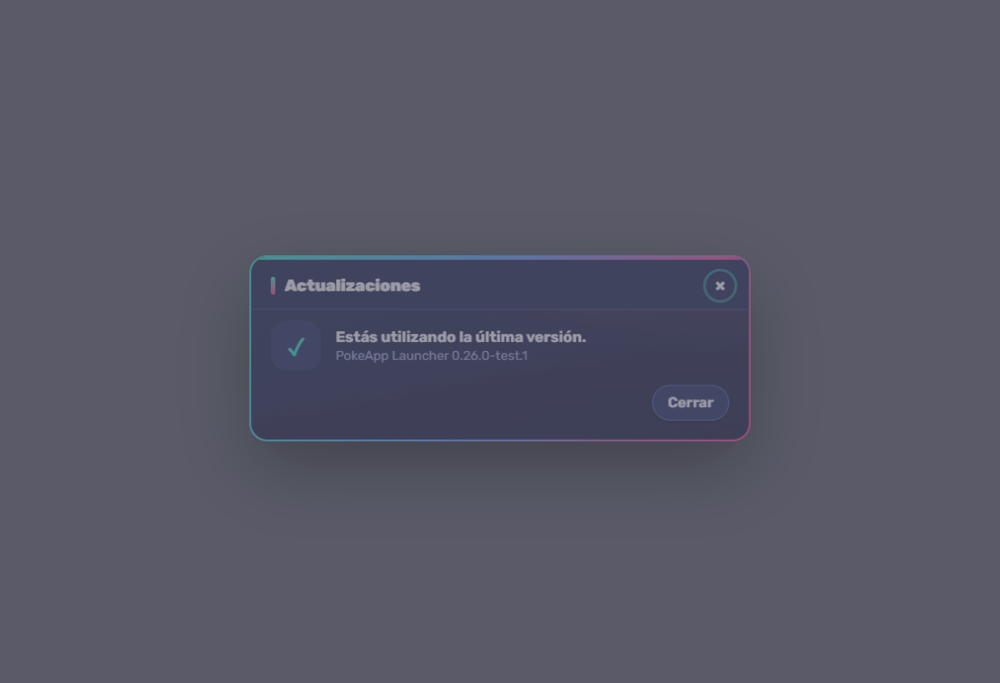

# POKEAPP — LAUNCHER UPDATES FINAL REPORT

2026-10-27. Scope: the Launcher updater only. **Nothing deployed or
published**: web, API, R2 and the public Launcher are unchanged; no
migration applied; no stable key created. The «sube todo público» request was
superseded by the owner before anything was uploaded (the web build and the
0.26.0 public build were stopped locally). Design and procedures:
[launcher-updates.md](launcher-updates.md).

## 1. What works

| Step | Status | Evidence |
| --- | --- | --- |
| Detect at start (quiet) and on «Buscar actualizaciones» | PASS PACKAGED | rehearsal |
| Popup by itself once per version; «Más tarde» remembered; manual check still shows it | PASS PACKAGED | rehearsal, UI smoke |
| «Estás utilizando la última versión» | PASS PACKAGED | rehearsal |
| Download with progress, single flight (no double download) | PASS PACKAGED | rehearsal |
| Ed25519 manifest (pinned key), channel, version, minimum version, HTTPS/loopback rules | PASS PACKAGED | rehearsal, unit |
| SHA-512 + size while downloading and again right before running | PASS PACKAGED | rehearsal (corrupted bytes refused) |
| Refusals: forged signature, downgrade, incompatible jump, wrong channel | PASS PACKAGED | rehearsal |
| Network loss: partial file removed, «Reintentar» | PASS PACKAGED | rehearsal |
| Install deferred during critical work (real recovery state in the core) | PASS PACKAGED | rehearsal |
| Core stopped and waited for before the installer replaces files | PASS PACKAGED | rehearsal (installer replaced every file) |
| Silent per-user install and automatic restart as the new version | PASS PACKAGED | rehearsal |
| Unfinished install recovered at the next start, also offline | PASS PACKAGED | rehearsal |
| Profile kept: selected save, configuration, known saves, DPAPI session, Electron data | PASS PACKAGED | rehearsal |
| Channel on Cloudflare/R2 (Worker routes) | PASS LOCAL | Worker tests; **not deployed** |
| Public stable channel active | PENDING EXTERNAL | needs key, Authenticode, authorization (§5) |
| Windows 10 | PENDING EXTERNAL | only Windows 11 (10.0.26300) available here |

## 2. Real update between two packaged versions

`tools/validate_launcher_update_e2e.mjs`, final run on builds made from the
final code (`1fd8399`): **28/28 PASS** ([evidence](evidence/launcher-updates/update-rehearsal.json)).

| Build | Version | Installer SHA-256 | Audit |
| --- | --- | --- | --- |
| A | 0.26.0-test.1 | `0e0ea30e…20180a9` (159 311 905 bytes) | PASS (private, `updatetest`, loopback feed, no private key) |
| B | 0.26.0-test.2 | `714094cf…9062981` (159 311 324 bytes) | PASS |

Isolation: «PokeApp Launcher UpdateTest» (own app id, install folder, profile
`%LOCALAPPDATA%\PokeApp\Launcher-UpdateTest` and sandbox APPDATA with one
synthetic save), loopback feed, Ed25519 key generated for the test and
deleted afterwards, no account. The owner's `Launcher` and `Launcher-Private`
profiles and installed Launcher were not touched. At the end the rehearsal
app was uninstalled with its own uninstaller: no install folder, no profile,
no uninstall entry left.

What ran, in order: real NSIS install of A → start-up check (nothing newer)
and «Estás utilizando la última versión» → synthetic save chosen
automatically → refusals with nothing downloaded: forged signature,
downgrade, incompatible jump, wrong channel → IPC: a forged ticket cannot
start an update; the web has no native bridge → corrupted bytes refused by
SHA-512 and removed → dropped connection: partial removed, «Reintentar» →
next start: popup by itself with notes → «Más tarde» → next start: no popup →
real pending recovery in the core (junction on the write folder): download
with progress, a repeated «Actualizar» downloads once, install deferred with
the verified file kept → Launcher killed before installing → next start with
the feed unreachable: «Instalar ahora» from the kept, re-verified file, no
second download → core stopped, silent install, **0.26.0-test.2 restarted by
itself** and cleared the installer → same profile on B: selected save,
`config.json`, `known-saves.json` and the DPAPI session byte-identical (the
session still decrypts), Electron data (localStorage) kept; the same feed is
now «última versión».

**Installed version at the end of the test: 0.26.0-test.2** (then removed).

### Defect found and fixed by the rehearsal

The NSIS installer starts the new version itself and can still be running,
so deleting its own `.exe` at start-up failed and the exception escaped app
start-up (the first launch after an update could miss its native views).
Fixed in `1fd8399`: cleanup is best-effort, retried a minute later and at the
next start, and never stops the Launcher from starting; unit test added.

### Captures (real app)

| | |
| --- | --- |
|  |  |
|  |  |
|  | |

(The grey area is the window behind the popup; captures include only the
native view.)

## 3. Tests

| Gate | Result |
| --- | --- |
| Updater unit tests | 12/12 |
| All Launcher node tests (updater, confirmations, webview, quantity, design) | 31/31 |
| Launcher UI smoke (incl. 9 update popup checks) | 54/54 |
| Worker channel routes | 4/4 |
| Package audit (4 rehearsal builds) | PASS |
| Real update rehearsal (final builds) | 28/28 |
| Windows 10 | not available here — PENDING EXTERNAL |

## 4. Problems found

- Post-update cleanup could break the first start (fixed, above).
- Harness only: CDP pointer clicks on the native view right after a resize,
  and acting before the page's 1 s poll; the rehearsal now waits for the
  page to show main's state. Not a player-facing issue.

## 5. To activate public updates (owner)

See [launcher-updates.md §6](launcher-updates.md#6-activating-the-public-channel-owner):
a real stable key (and a separate private key) kept offline; an Authenticode
certificate (the signer refuses an unsigned stable manifest — kept on
purpose); authorization to deploy the Worker routes and upload the bridge
installer and the first `updates/stable.json`. Then players install the
bridge once from «Descargar Launcher»; every later version arrives with one
click. Publishing steps: [§7](launcher-updates.md#7-publishing-a-new-version-once-active).

## 6. Production (unchanged)

Web `a7e33476`, API `501a399`, public Launcher 0.25.0, R2 unchanged, no
migration applied, no stable key, nothing deployed or published.

